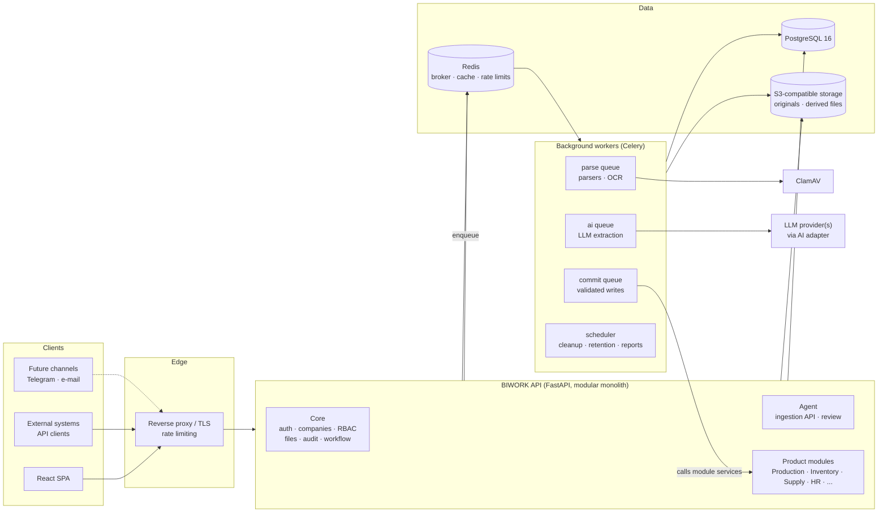
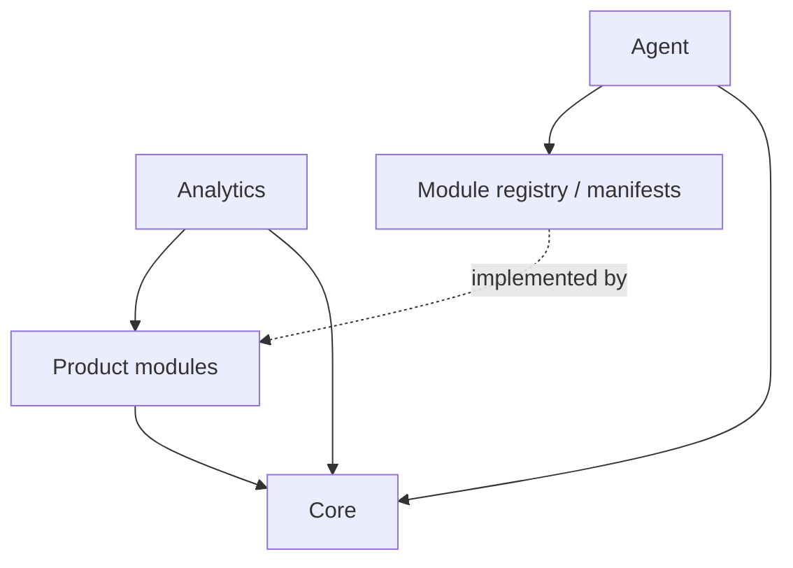
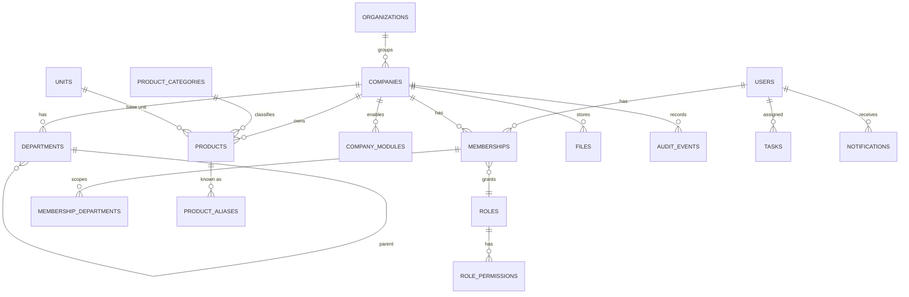
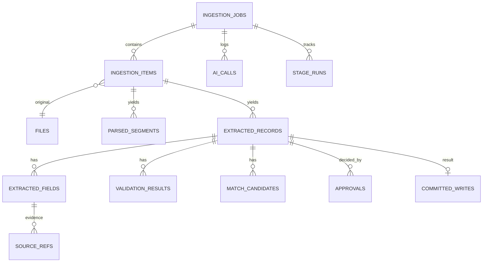
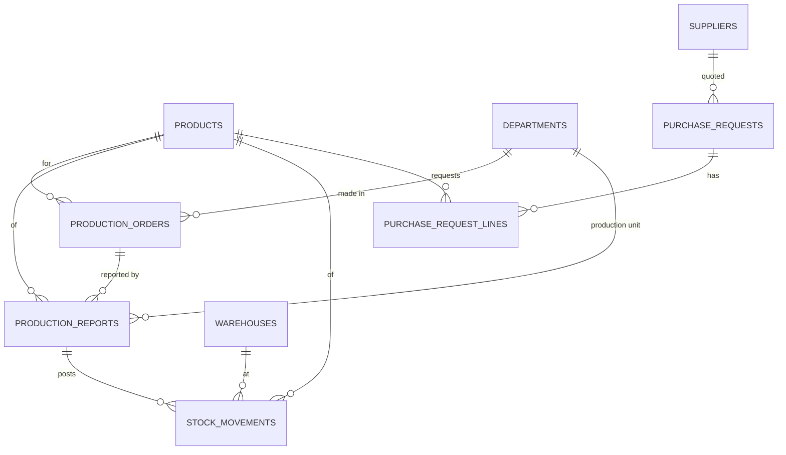
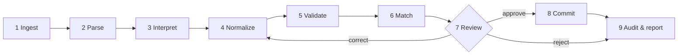

# BIWORK Platform Architecture

> **Status:** v0.2 — implemented for Phases 1–3 (see [§15 Implementation status](#15-implementation-status)) · **Scope:** MVP (Phases 1–2) in detail; Phases 3–4 as direction
> **Audience:** engineers building BIWORK Core, BIWORK Agent, and the first product modules

BIWORK is an AI-powered management platform for manufacturing companies, factories, and
industrial holdings. It is one ecosystem: a shared core (BIWORK Core), a central intelligent
data-intake engine (BIWORK Agent), and a set of product modules (Production, Inventory,
Supply, HR, EDO, Finance, Maintenance, Quality, Analytics) that share one data infrastructure
and one set of security, user-management, and audit standards.

This document defines how those pieces fit together: the module structure, the data model,
the FastAPI service boundaries, the AI layer, and the deployment topology. It is the
reference for design decisions; where code and this document disagree, fix one of them in the
same pull request.

---

## Contents

1. [Guiding principles](#1-guiding-principles)
2. [System overview](#2-system-overview)
3. [Module structure](#3-module-structure)
4. [Data model](#4-data-model)
5. [FastAPI service boundaries](#5-fastapi-service-boundaries)
6. [BIWORK Agent pipeline](#6-biwork-agent-pipeline)
7. [AI layer](#7-ai-layer)
8. [Security and governance](#8-security-and-governance)
9. [Frontend](#9-frontend)
10. [Deployment](#10-deployment)
11. [Observability and operations](#11-observability-and-operations)
12. [Testing strategy](#12-testing-strategy)
13. [Roadmap mapping](#13-roadmap-mapping)
14. [Decision log and open questions](#14-decision-log-and-open-questions)
15. [Implementation status](#15-implementation-status)

---

## 1. Guiding principles

1. **The LLM proposes, the backend disposes.** AI output is a *proposal*. Only deterministic,
   permission-checked module services write business data. No model ever produces SQL,
   chooses a table name, grants permissions, or triggers a financial/HR/production action.
2. **Structured records, not text blobs.** Business data lives in normalized relational tables
   with foreign keys and constraints. JSONB is reserved for source payloads and extraction
   metadata.
3. **Never invent values.** Missing stays missing; low confidence stays unverified until a
   person confirms it. Every saved value is traceable to its source (file, page, cell, or
   text span).
4. **One platform, many modules.** Modules are separate logical units with their own schemas
   and services, sharing one database, one identity system, and one audit trail. New modules
   plug in without changes to the core.
5. **Tenant isolation is enforced twice.** Company scoping happens in the application layer
   *and* in PostgreSQL row-level security.
6. **Every stage is recoverable.** Long work runs in background jobs whose stages are
   idempotent, observable, and safely retryable.
7. **Provider independence.** OCR engines and LLM providers are adapters chosen by
   configuration. A clearly labelled mock adapter exists for development and tests and is
   never presented as real AI analysis.

---

## 2. System overview



**Shape of the system.** BIWORK starts as a **modular monolith**: one FastAPI codebase,
deployed as an API process plus several worker processes built from the same image. Modules
are isolated by package boundaries, database schemas, and explicit service interfaces rather
than by network hops. This keeps transactions simple (a production report and its inventory
movement commit together), keeps the team small, and leaves a clean seam to extract a module
into its own service later if load or ownership ever requires it (see §14).

---

## 3. Module structure

### 3.1 Platform layers

| Layer | Responsibility | Examples |
|---|---|---|
| **Core** | Identity, tenancy, permissions, master data, files, audit, notifications, workflow, search, integration settings | `core.auth`, `core.companies`, `core.files`, `core.audit` |
| **Agent** | Turning raw input into validated, approved records, then handing them to module services | ingestion jobs, parsers, AI extraction, review queue |
| **Product modules** | Domain data and business rules for one area of the business | Production, Inventory, Supply, HR, EDO, Finance, Maintenance, Quality |
| **Analytics** | Read-only aggregation over module data; KPIs, dashboards, reports | executive dashboard, plan vs actual |

### 3.2 Module catalogue

| Module | Owns | MVP phase |
|---|---|---|
| **Core** | companies, users, roles, departments, master data (products, units, currencies), files, audit, notifications, tasks | 1 |
| **Agent** | ingestion jobs/items, extracted records and fields, validation results, approvals, AI logs, import policies | 2 |
| **Production** | production orders, reports, lines, shifts, plans | 2 (reports, orders) → 3 |
| **Inventory** | warehouses, stock movements, balances, batches | 2 (movements) → 3 |
| **Supply** | suppliers, purchase requests, deliveries, material requirements | 2 (purchase requests, for Scenario C) → 4 |
| **HR** | employees, org structure, attendance, shifts, leave | 4 |
| **EDO** | registered documents, correspondence, document approvals, deadlines | 4 |
| **Finance** | budgets, cost calculations, expenses, profitability | 4 |
| **Maintenance** | equipment register, maintenance plans, repair requests, downtime | 4 |
| **Quality** | inspections, defects, nonconformities, corrective actions, traceability | 4 (defect counts are captured on production reports from Phase 2) |
| **Analytics** | KPIs, dashboards, reports, forecasts | 1 (basic dashboard) → 3+ |

### 3.3 Anatomy of a module

Every product module follows the same internal layout so that the Agent, the permission
system, and the frontend can discover it uniformly:

```
backend/app/modules/production/
├── __init__.py          # registers the module manifest
├── manifest.py          # code, name, permissions, record types, nav entry
├── models.py            # SQLAlchemy models (schema "production")
├── schemas.py           # Pydantic API + ingestion schemas
├── service.py           # business operations — the ONLY write path
├── rules.py             # deterministic business rules / validators
├── matchers.py          # entity matching for agent ingestion
├── router.py            # FastAPI router mounted at /api/v1/production
└── tests/
```

The **module manifest** is the contract between a module and the platform:

```python
ModuleManifest(
    code="production",
    permissions=["production.read", "production.write", "production.approve"],
    record_types=[
        RecordTypeSpec(
            code="production_report",
            schema=ProductionReportIn,          # Pydantic: the extraction target
            description="Output, accepted and defective quantities for a product, unit, date",
            normalizer=normalize_production_report,
            validators=[quantities_reconcile, product_exists, unit_exists, date_not_future],
            matcher=match_production_report,    # duplicate/existing-record detection
            writer=ProductionService.create_report,
            approval_policy="required",          # or "auto_if_enabled"
        ),
        ...
    ],
)
```

The Agent never imports module internals beyond the manifest. To make a new kind of record
ingestible, a module adds a `RecordTypeSpec`; nothing in the Agent changes. This is how
"BIWORK Agent processes information for every enabled module, but only through that module's
schemas, rules, permissions, and services" is enforced structurally.

### 3.4 Dependency rules



- Core depends on nothing above it.
- Modules depend on Core. A module may call another module **only through that module's
  public `service.py` functions** (e.g. Production → `InventoryService.post_movement`), never
  its models or tables.
- Agent depends on Core and on the registry, not on individual modules.
- Analytics reads through dedicated SQL views / read models; it never writes module data.
- An import-linter contract in CI enforces these rules.

---

## 4. Data model

### 4.1 Database layout

- **One PostgreSQL 16 database**, one **schema per module**: `core`, `agent`, `production`,
  `inventory`, `supply`, `hr`, `edo`, `finance`, `maintenance`, `quality`, `analytics`.
  Separate databases per module are explicitly avoided (no cross-database transactions or
  foreign keys).
- **Migrations:** Alembic, one linear history for the whole database. Each module owns the
  migrations that touch its schema.
- **Keys:** `uuid` primary keys (UUIDv7 for index locality), generated by the application.
  Human-facing numbers (e.g. `PR-2026-000123`) are separate, per-company sequences.
- **Common columns** on every business table:

  | Column | Purpose |
  |---|---|
  | `id uuid` | primary key |
  | `company_id uuid not null` | tenant scope; FK to `core.companies`; RLS key |
  | `created_at / created_by` | provenance |
  | `updated_at / updated_by` | provenance |
  | `version int` | optimistic locking; bumped on every update |
  | `source_record_id uuid null` | FK to `agent.extracted_records` when the row came from the Agent |
  | `deleted_at timestamptz null` | soft delete where retention rules require it |

- **Money** is `numeric(18,4)` plus a `currency char(3)`; **quantities** are
  `numeric(18,4)` plus a `unit_id` FK. Never floats.
- **Dates** are stored as `date` or `timestamptz` (UTC); display time zone is a company
  setting.

### 4.2 Core schema



| Table | Key columns / notes |
|---|---|
| `organizations` | holding/group; optional parent of companies |
| `companies` | `organization_id`, `name`, `tin`, `settings jsonb` (locale, time zone, default currency, date formats, AI data-handling policy) |
| `company_modules` | `company_id`, `module_code`, `enabled`, `config jsonb` |
| `users` | `email` unique, `password_hash` (argon2id), `is_active`, `mfa_secret` (encrypted), `is_platform_admin` |
| `roles` | `company_id` (null = system role template), `code`, `name` |
| `role_permissions` | `role_id`, `permission` (e.g. `production.approve`) |
| `memberships` | `user_id`, `company_id`, `role_id`, unique (`user_id`,`company_id`,`role_id`) |
| `membership_departments` | restricts a membership to departments (department-level access) |
| `departments` | `company_id`, `parent_id`, `code`, `name`, `kind` (workshop/"sex", warehouse, office…) |
| `units` | `code` (pcs/"dona", kg, m, l…), `dimension`, `factor_to_base` — conversion table |
| `unit_aliases` | free-text spellings → `unit_id` (e.g. "dona", "шт", "pcs") |
| `product_categories` | `company_id`, `parent_id`, `name` |
| `products` | `company_id`, `code` unique per company, `name`, `category_id`, `base_unit_id`, `is_active` |
| `product_aliases` | `product_id`, `alias`, `normalized_alias` (trigram index) — powers entity matching |
| `files` | `company_id`, `storage_key`, `sha256`, `size`, `mime_type`, `original_name`, `scan_status` (pending/clean/infected), `uploaded_by` |
| `tasks` | `company_id`, `assignee_id`, `title`, `due_at`, `status`, `ref_type/ref_id` |
| `notifications` | `user_id`, `company_id`, `kind`, `payload jsonb`, `read_at` |
| `workflow_definitions` | `company_id`, `record_type`, `steps jsonb` (approver roles, auto-approve flag) |
| `audit_events` | append-only; see §4.6 |
| `api_clients` | machine credentials for system-to-system ingestion: hashed key, scopes, company |
| `idempotency_keys` | `company_id`, `key`, `request_hash`, `response jsonb`, `expires_at` |

### 4.3 Agent schema

This is the heart of traceability: every saved business record can be walked back to the
input that produced it.



| Table | Key columns / notes |
|---|---|
| `ingestion_jobs` | `company_id`, `submitted_by`, `channel` (web/api/email/telegram), `source_kind` (text/file/form/api), `status`, `current_stage`, `import_policy` (all_or_nothing / valid_rows_only / stop_on_first_error), `idempotency_key`, `content_fingerprint`, `pipeline_version`, `stats jsonb` |
| `ingestion_items` | one per file or text block: `job_id`, `file_id` null, `raw_text` null, `detected_format`, `sha256`, `status`, `error` |
| `parsed_segments` | normalized parser output: `item_id`, `kind` (text/table/row/image_region), `page`, `sheet`, `row_index`, `content jsonb`, `ocr_confidence` |
| `column_mappings` | for spreadsheets: `item_id`, `source_column`, `target_field`, `confidence`, `confirmed_by` |
| `extracted_records` | `job_id`, `item_id`, `record_type` (e.g. `production_report`), `target_module`, `status` (draft → needs_review → approved/rejected → committed/failed), `payload jsonb` (current proposed values), `requires_review`, `row_ref` |
| `extracted_fields` | `record_id`, `field`, `raw_value`, `normalized_value jsonb`, `confidence numeric(4,3)`, `state` (high_confidence / low_confidence / missing / conflicting / invalid / needs_approval), `edited_by`, `edited_at` |
| `source_refs` | `field_id`, `file_id`, `page`, `sheet`, `cell`, `bbox`, `text_span` (start,end), `excerpt` |
| `validation_results` | `record_id`, `field` null, `rule_code`, `severity` (error/warning/info), `message`, `details jsonb` |
| `match_candidates` | `record_id`, `entity_type`, `entity_id`, `score`, `match_kind` (exact/alias/fuzzy/duplicate_record), `selected` |
| `approvals` | `record_id`, `decided_by`, `decision` (approve/reject/correct), `comment`, `diff jsonb`, `decided_at` |
| `committed_writes` | `record_id`, `target_table`, `target_id`, `operation` (insert/update), `idempotency_key` unique, `committed_at` |
| `stage_runs` | `job_id`, `item_id`, `stage`, `attempt`, `status`, `started_at`, `finished_at`, `error` — per-stage observability and retry history |
| `ai_calls` | `job_id`, `stage`, `provider`, `model`, `prompt_id`, `prompt_version`, `schema_version`, `input_tokens`, `output_tokens`, `cost`, `latency_ms`, `status`, `request_redacted jsonb`, `response jsonb` |
| `extraction_feedback` | human corrections (`field`, `model_value`, `corrected_value`) used for evaluation datasets |

Duplicate protection for **whole uploads** (Scenario D) uses `content_fingerprint`
(SHA-256 of normalized content) with a partial unique index per company over
non-failed jobs; a re-upload is detected before any AI cost is spent and the user is shown
the previous job. Duplicate protection for **individual records** is the module matcher plus
a module-level natural-key unique constraint (see §4.4).

### 4.4 Product module schemas (MVP entities)



**production**

| Table | Key columns / constraints |
|---|---|
| `production_lines` | `department_id`, `code`, `capacity_per_shift` |
| `shifts` | `company_id`, `code`, `starts_at`, `ends_at` |
| `production_orders` | `number`, `product_id`, `department_id`, `planned_qty`, `unit_id`, `planned_start`, `planned_end`, `status` |
| `production_reports` | `number`, `production_date`, `product_id`, `department_id`, `line_id` null, `shift_id` null, `order_id` null, `qty_produced`, `qty_accepted`, `qty_defective`, `unit_id`, `status` (draft/approved/cancelled), `supersedes_id` null. **CHECK** `qty_accepted + qty_defective <= qty_produced` (equality enforced as a warning-level rule, since rework may be pending). **Natural key** unique (`company_id`, `production_date`, `product_id`, `department_id`, `shift_id`) where not cancelled. |
| `production_plans` | Phase 3 |

**inventory**

| Table | Key columns / constraints |
|---|---|
| `warehouses` | `department_id`, `code`, `kind` (raw/finished/wip) |
| `stock_movements` | `warehouse_id`, `product_id`, `qty` (signed), `unit_id`, `movement_type` (receipt/issue/production_output/adjustment/transfer), `batch_code`, `ref_type`, `ref_id`, `occurred_at`. Append-only. |
| `stock_balances` | materialized per (`warehouse_id`, `product_id`, `batch_code`), maintained in the same transaction as the movement |

**supply**

| Table | Key columns / constraints |
|---|---|
| `suppliers` | `company_id`, `name`, `tin` unique per company, `aliases` (via `supplier_aliases`) |
| `purchase_requests` | `number`, `requested_by_employee` (text or FK once HR exists), `department_id`, `needed_by`, `status`, `source_file_id` |
| `purchase_request_lines` | `request_id`, `product_id` null, `description`, `qty`, `unit_id`, `est_price`, `currency` |

Later modules (HR, EDO, Finance, Maintenance, Quality) follow the same conventions; their
tables are designed when the phase starts, against real master data.

### 4.5 Versioning and corrections

- Business records are **never edited silently**. Updates go through the module service,
  bump `version`, and write an audit event with the field-level diff.
- Corrections to approved operational facts (e.g. a production report) create a **new record
  that supersedes** the old one (`supersedes_id`); the old one is marked `cancelled`, and
  any derived postings (stock movements) are reversed by compensating entries. History is
  never rewritten.

### 4.6 Audit events

`core.audit_events` is append-only (no UPDATE/DELETE granted to the application role):

| Column | Notes |
|---|---|
| `id`, `occurred_at` | |
| `company_id`, `actor_type` (user/api_client/system/agent), `actor_id` | |
| `action` | `production_report.created`, `agent.record.approved`, `auth.login_failed`, … |
| `entity_type`, `entity_id` | |
| `changes jsonb` | field-level before/after |
| `context jsonb` | request id, ip, user agent, `ingestion_job_id`, `pipeline_version`, `prompt_version` |
| `prev_hash`, `hash` | hash chain per company for tamper evidence |

Scenario G (auditability) is answered by joining `audit_events` → `committed_writes` →
`extracted_records` → `extracted_fields`/`source_refs`/`validation_results`/`approvals` →
`ingestion_items` → `files`.

### 4.7 Tenant isolation in the database

- Every tenant-scoped table has `company_id` and a **row-level security policy**:
  `USING (company_id = current_setting('app.company_id')::uuid)`.
- The API sets `SET LOCAL app.company_id = …` at the start of each transaction, from the
  authenticated membership, never from request input alone.
- The application connects as a non-owner role without `BYPASSRLS`. Migrations run as a
  separate owner role.
- Cross-company reads (holding-level analytics) go through explicit, audited services that
  iterate over companies the user is a member of.

---

## 5. FastAPI service boundaries

### 5.1 Application layout

```
backend/
├── app/
│   ├── main.py                 # app factory; mounts routers from enabled module manifests
│   ├── config.py               # pydantic-settings; all config from env
│   ├── db/                     # engine, session, RLS helper, base model
│   ├── core/                   # auth, companies, users, roles, files, audit, tasks, notifications, search
│   ├── agent/
│   │   ├── api.py              # /agent endpoints
│   │   ├── pipeline/           # one module per stage: ingest, parse, interpret, normalize, validate, match, review, commit, report
│   │   ├── parsers/            # text, csv, xlsx/xls, docx, pdf, image/OCR
│   │   ├── registry.py         # collects RecordTypeSpecs from module manifests
│   │   └── tasks.py            # Celery task wrappers
│   ├── ai/                     # provider-independent AI layer (§7)
│   ├── modules/                # production, inventory, supply, ... (§3.3)
│   ├── analytics/
│   └── workers/celery_app.py
├── migrations/                 # Alembic
└── tests/
frontend/                       # React + TypeScript + Vite + Tailwind
deploy/                         # Dockerfiles, compose files, nginx, k8s manifests (later)
docs/
```

### 5.2 Layering inside the backend

```
HTTP router  →  application service  →  domain rules  →  repository (SQLAlchemy)  →  PostgreSQL
                     ↑
     Agent commit stage calls the same service function
```

- **Routers** only parse/validate HTTP input (Pydantic), resolve the caller context, and call
  a service. No SQL in routers.
- **Services** own transactions, authorization checks, business rules, audit events, and
  cross-module calls. They are the only write path, for humans *and* for the Agent.
- **Repositories** use SQLAlchemy 2.0 with bound parameters only. Raw SQL is limited to
  reviewed, parameterized analytics views.

### 5.3 Request context

Every request resolves a `RequestContext` dependency:

```python
@dataclass(frozen=True)
class RequestContext:
    user_id: UUID | None
    api_client_id: UUID | None
    company_id: UUID                # from X-Company-Id header, verified against memberships
    permissions: frozenset[str]     # from role(s) in that company
    department_ids: frozenset[UUID] | None   # None = all departments
    request_id: str
```

Services receive the context explicitly; authorization helpers
(`ctx.require("production.write")`, `ctx.require_department(dep_id)`) are called inside
services, so the Agent commit path is checked identically to the HTTP path. The Agent commits
**as the approving user** (or as a narrowly-scoped system actor for administrator-enabled
auto-approval), never with elevated rights.

### 5.4 REST surface (v1)

All endpoints are under `/api/v1`, documented by the generated OpenAPI schema, versioned by
path. Company scope comes from the `X-Company-Id` header.

| Area | Endpoints (representative) |
|---|---|
| **Auth** | `POST /auth/login`, `POST /auth/refresh`, `POST /auth/logout`, `GET /auth/me` |
| **Core admin** | `/companies`, `/companies/{id}/modules`, `/users`, `/roles`, `/memberships`, `/departments` |
| **Master data** | `/master/products`, `/master/product-categories`, `/master/units`, `/master/products/{id}/aliases` |
| **Files** | `POST /files` (multipart, size/type checked, virus scanned async), `GET /files/{id}` (signed URL) |
| **Agent** | `POST /agent/jobs` (text, files, or form payload; `Idempotency-Key` header), `GET /agent/jobs`, `GET /agent/jobs/{id}` (status, stage, stats), `GET /agent/jobs/{id}/records`, `GET /agent/records/{id}` (fields, confidence, sources, validation, matches), `PATCH /agent/records/{id}` (correct field values → re-validate), `PUT /agent/jobs/{id}/items/{item}/mapping` (column mapping), `POST /agent/records/{id}/approve`, `POST /agent/records/{id}/reject`, `POST /agent/jobs/{id}/approve` (bulk, per import policy), `POST /agent/jobs/{id}/retry`, `GET /agent/jobs/{id}/error-report` (XLSX), `GET /agent/record-types` |
| **Production** | `/production/orders`, `/production/reports`, `/production/lines`, `/production/shifts` |
| **Inventory** | `/inventory/warehouses`, `/inventory/movements`, `/inventory/balances` |
| **Supply** | `/supply/suppliers`, `/supply/purchase-requests` |
| **Tasks / notifications** | `/tasks`, `/notifications`, `GET /events` (SSE stream for job progress and notifications) |
| **Analytics** | `/analytics/overview` (KPI cards), `/analytics/production/plan-vs-actual`, `/analytics/agent/stats` |
| **Audit** | `GET /audit/events`, `GET /audit/trace/{entity_type}/{entity_id}` (full provenance chain) |
| **Ops** | `GET /health/live`, `GET /health/ready`, `GET /admin/system/queues` |

**Conventions:** cursor pagination (`?cursor=&limit=`), filtering via explicit query
parameters, RFC 9457 problem+json errors, `ETag`/`If-Match` on updates for optimistic
locking, `Idempotency-Key` on every non-idempotent POST that creates business data or jobs.

### 5.5 Idempotency

- **API level:** `core.idempotency_keys` stores (`company_id`, `key`, `request_hash`,
  `response`). A repeated key with the same body returns the stored response; a different
  body returns `409`.
- **Commit level:** each approved extracted record gets a deterministic key
  `sha256(record_id, payload_version)`. `committed_writes.idempotency_key` is unique, and the
  business insert and the `committed_writes` row are in **the same transaction**. A retried
  commit either finds the existing row (and reports success) or performs the write — never
  both (Scenario F).

### 5.6 Async boundaries

| Work | Where | Why |
|---|---|---|
| Auth, CRUD, approvals, small text ingestion preview | API process, synchronous | user is waiting, work is short |
| Virus scan, parsing, OCR, spreadsheet profiling | `parse` queue | CPU heavy, can be slow |
| LLM classification / extraction | `ai` queue | network-bound, rate-limited, retried |
| Committing approved records (esp. bulk) | `commit` queue | transactional batches, must not block the UI |
| Error reports, retention, cleanup, KPI rollups | `scheduled` queue (Celery beat) | periodic |

Job progress is pushed to the browser via **Server-Sent Events** (backed by Redis pub/sub),
with polling of `GET /agent/jobs/{id}` as the fallback.

---

## 6. BIWORK Agent pipeline

### 6.1 Stages



| # | Stage | Input → output | Implementation | Deterministic? |
|---|---|---|---|---|
| 1 | **Ingest** | upload/text/API payload → `ingestion_job`, `ingestion_items`, stored originals | size/type allow-list, magic-byte check, SHA-256, fingerprint duplicate check, ClamAV scan, store to S3 | yes |
| 2 | **Parse** | item → `parsed_segments` | format-specific parser (§6.3); OCR when no text layer | yes |
| 3 | **Interpret** | segments → candidate `record_type` + raw field values with confidence and source spans | AI layer: classify, then schema-constrained extraction using the target `RecordTypeSpec.schema` | **no (AI)** |
| 4 | **Normalize** | raw values → canonical values | date parsing with company locale (incl. Uzbek/Russian month names, e.g. "21-oktabr"), unit alias → `unit_id`, currency codes, number formats, whitespace/case/transliteration for names | yes |
| 5 | **Validate** | record → `validation_results` | Pydantic schema, required fields, types, referential checks, module `validators` (e.g. accepted + defective = produced) | yes |
| 6 | **Match** | record → `match_candidates` | exact code → alias → trigram fuzzy match on master data; natural-key lookup for existing/duplicate records | yes |
| 7 | **Review** | record → `approvals` | UI preview with confidence, sources, diffs vs existing data; edit/approve/reject; optional admin-enabled auto-approval for low-risk types with zero warnings and all fields high-confidence | human |
| 8 | **Commit** | approved record → business row(s) + `committed_writes` | Celery task calls `RecordTypeSpec.writer` (module service) inside a transaction with idempotency key | yes |
| 9 | **Audit & report** | job → summary | audit events, job stats ("6 fields extracted, 6 validated, 1 product matched, record saved: PR-2026-000123"), error report XLSX | yes |

Only stage 3 uses a language model. Everything after it is deterministic code that treats the
model's output as untrusted input.

### 6.2 Orchestration and recovery

- Each stage is a **pure-ish function** `run_stage(job_id, item_id) -> StageResult` that
  reads its inputs from the database and writes its outputs in one transaction, then enqueues
  the next stage. Stages are **idempotent**: re-running a stage replaces its own outputs for
  that item and attempt.
- `stage_runs` records each attempt. Transient errors (network, 429, 5xx) retry with
  exponential backoff and jitter; permanent errors mark the item `failed` with a reason.
- A failed job can be retried from its **last successful stage** via
  `POST /agent/jobs/{id}/retry` (Scenario F). Because commit is guarded by idempotency keys,
  a retry after a partial commit never duplicates rows.
- A watchdog task re-enqueues stages stuck in `running` past their timeout.
- `pipeline_version` (git SHA + config hash) is stamped on every job for auditability.

### 6.3 Parsers

| Format | Library / tool | Notes |
|---|---|---|
| Plain text / pasted tables | built-in; TSV/markdown table detection | pasted Excel arrives as TSV |
| CSV | `csv` + `charset-normalizer` for encoding, delimiter sniffing | cp1251 is common for Russian sources |
| XLSX | `openpyxl` (read-only, data-only) | sheets, merged cells, header-row detection, typed cells |
| XLS | `xlrd` or LibreOffice headless → XLSX | |
| DOCX | `python-docx` | paragraphs + tables |
| PDF (text) | `pdfplumber` / `pypdfium2` | text with page numbers and bounding boxes; table extraction |
| PDF (scanned) / images / photos | `pdf2image` + Tesseract 5 (`eng`, `rus`, `uzb`, `uzb_cyrl`), OpenCV pre-processing (deskew, denoise, contrast) | per-word confidence → `ocr_confidence`; vision-capable LLM is an optional, policy-gated alternative |
| Structured forms / API payloads | Pydantic validation against the record type schema | skip stage 3 when the payload is already structured |

Parsers emit a common `ParsedDocument` (segments with page/sheet/row/bbox references), so the
rest of the pipeline is format-agnostic.

### 6.4 Spreadsheet imports (large files)

1. **Profile** (parse queue): detect sheets, header row, column types, empty/merged rows.
2. **Map columns** once per sheet, not per row: deterministic header matching against the
   target schema and saved per-company mapping templates first; the LLM proposes a mapping
   only for unresolved columns, on headers and a small sample of rows.
3. User confirms or edits the mapping in the UI (`column_mappings.confirmed_by`).
4. **Rows are processed deterministically** (normalize → validate → match) in batches of
   ~500, with no per-row LLM calls. This makes 10,000-row files fast, cheap, and reproducible.
5. **Import policy** decides commit behaviour:
   - `all_or_nothing` — one transaction; any invalid row blocks the import.
   - `valid_rows_only` (default) — each batch commits in its own transaction; invalid rows
     are reported and left pending for correction.
   - `stop_on_first_error` — commit batches until the first invalid row.
6. Results: counts of committed / failed / pending rows plus a downloadable XLSX error report
   (original row, column, problem, suggested fix).

### 6.5 Confidence model

Each field ends up in exactly one state:

| State | How it is set | UI treatment | Can auto-approve? |
|---|---|---|---|
| `high_confidence` | model confidence ≥ threshold **and** deterministic checks pass **and** (for references) exact/alias match | plain | yes, if enabled |
| `low_confidence` | below threshold, OCR confidence low, or fuzzy-only match | amber, must be confirmed | no |
| `missing` | value not found in source | empty, red if required | no |
| `conflicting` | multiple different values in source, or disagrees with existing record | red, shows both | no |
| `invalid` | fails type/rule validation | red with rule message | no |
| `needs_approval` | value is fine but the record type or amount requires sign-off | blue | no |

Confidence thresholds are per record type and per company. Model-reported confidence is
combined with deterministic signals (OCR confidence, match kind, rule outcomes); it is never
trusted on its own. A reference that cannot be resolved with confidence (e.g. an unreadable
product code) is left unresolved with candidate suggestions — the system never picks one
arbitrarily.

---

## 7. AI layer

### 7.1 Responsibilities and separation

> The multi-provider engine (OpenAI primary, Gemini, Anthropic, labelled demo mode), task-based
> routing, fallbacks, usage monitoring and evaluation are specified in detail in
> [ai-engine.md](ai-engine.md); this section keeps the architectural view.

```
app/ai/
├── providers/
│   ├── base.py         # LLMProvider protocol, error kinds, untrusted-data wrapping
│   ├── openai.py       # primary provider (Responses API, strict structured output)
│   ├── gemini.py       # alternative provider (google-genai, JSON-schema output)
│   ├── anthropic.py    # optional provider (messages.parse)
│   └── demo.py         # deterministic, clearly labelled demo mode (no credentials)
├── router.py           # task → tier → provider/model candidates; fallback order
├── routing.default.json# routing rules (tiers, escalation), overridable with AI_ROUTING_FILE
├── health.py           # per-provider circuit breaker
├── cache.py            # company-scoped cache for classification / column mapping
├── ocr/                # OCRProvider protocol, tesseract adapter
├── prompts/            # versioned prompt templates (files, not inline strings)
├── extraction.py       # classify(), extract() (with escalation), map_columns(); retries, fallback, usage rows
├── policy.py           # data-handling policy enforcement & redaction
└── budget.py           # rate limits, price table, cost estimation
app/agent/usage.py      # usage monitoring report (cost per document / per validated record)
app/agent/evaluation.py # provider/model evaluation on eval/dataset (python -m app.cli ai-eval)
```

The concerns the spec lists are kept in separate code units:

| Concern | Lives in |
|---|---|
| Document parsing and OCR | `agent/parsers`, `ai/ocr` |
| AI classification and extraction | `ai/extraction.py` |
| Structured output generation | provider adapters (schema-constrained output) |
| Deterministic validation | module `rules.py`, `agent/pipeline/validate.py` |
| Entity matching | module `matchers.py`, `agent/pipeline/match.py` |
| Business rules | module `rules.py` / `service.py` |
| Database operations | module services and repositories |
| Approval workflows | `agent/pipeline/review.py`, `core/workflow` |
| Explanations and summaries | `ai/extraction.py` (`summarize_job`), display-only |

### 7.2 Provider interface

```python
class LLMProvider(Protocol):
    name: str
    is_mock: bool

    async def extract(
        self,
        *,
        task: ExtractionTask,          # prompt id/version, system instructions
        content: list[ContentBlock],   # text, table, or image blocks — always wrapped as untrusted data
        output_schema: type[BaseModel],# JSON-schema-constrained output target
        timeout_s: float,
    ) -> ExtractionResult: ...          # parsed model instance + usage + raw response + model id
```

- **Structured outputs:** adapters use the provider's native JSON-schema-constrained output
  (for the Anthropic adapter, `client.messages.parse(..., output_format=Model)` with the
  Pydantic schema from the `RecordTypeSpec`). The result is **re-validated with Pydantic**
  regardless; a validation failure is a retryable error with one repair attempt, then the
  item fails visibly.
- **Extraction envelope:** the model returns, per field, `value`, `confidence`
  (0–1), `source_quote`, and `not_found: bool`. The envelope is generated from the record
  type schema so each module only defines its business fields.
- **Model selection:** a configurable router picks a tier per task (economy for classification
  and column mapping, default for routine extraction, complex for escalation, vision for images)
  and resolves it to `<PROVIDER>_MODEL_<TIER>` settings, in provider order with fallback
  (ai-engine.md §3). Business logic never names a model or a vendor.
- **Demo mode:** with no credentials, a deterministic rule-based provider stands in. Every job
  processed with it is flagged (`ai_is_mock`, `ai_mode="demo"`) with a "Demo mode — not real AI
  analysis" warning, and its records are never auto-approved.

### 7.3 Reliability, rate limits, and cost

- Per-call timeout (default 60 s, configurable), retries with exponential backoff + jitter on
  timeouts, 429, and 5xx; honour `retry-after`.
- A Redis token bucket limits concurrent calls and tokens/minute per provider and per company.
- All calls go through the `ai` Celery queue with bounded concurrency, so a large upload
  cannot starve other companies.
- Every call writes an `ai_calls` row: provider, model, prompt id + version, schema version,
  tokens, cost, latency, outcome. Analytics surfaces AI usage and cost per company and per
  record type; per-company monthly budgets can pause AI stages with a clear message.

### 7.4 Prompt and schema versioning

- Prompts are files in `ai/prompts/<task>/<version>.md` with a changelog; the version is
  logged on every call and every job.
- Record-type schemas carry a `schema_version`. Changing a prompt or schema requires
  passing the evaluation suite (§7.6).

### 7.5 Privacy and data-handling controls

Configured per company (`companies.settings.ai_policy`) and enforced in `ai/policy.py`:

| Setting | Effect |
|---|---|
| `external_ai_allowed` | if false, only local parsers/OCR and the deterministic pipeline run; Interpret stage requires a self-hosted model adapter or manual mapping |
| `allowed_providers` | allow-list of adapters |
| `send_images_to_ai` | whether scanned pages/photos may be sent to a vision model, or only OCR text |
| `redaction_rules` | patterns removed before sending (personal IDs, bank accounts, phone numbers, salary figures) |
| `minimize_context` | send only the relevant segments (e.g. headers + sample rows), never whole workbooks |
| `retain_ai_payloads_days` | how long redacted request/response bodies are kept in `ai_calls` |

Each adapter's privacy implications (data location, retention, training use, sub-processors)
are documented in `docs/ai-providers.md` and shown to administrators when enabling it.

### 7.6 Evaluation and human feedback

- `ai/evals/` holds golden datasets per record type: input files/text, expected structured
  output. Includes Uzbek (Latin and Cyrillic), Russian, and mixed-language samples, scanned
  documents, and adversarial documents containing injected instructions.
- Metrics: field-level precision/recall, exact-match rate, confidence calibration
  (are "high confidence" fields actually correct?), and false-auto-approval rate.
- CI runs the eval suite against the mock adapter on every PR; a scheduled job runs it
  against the real provider and records results by prompt/model version.
- Every user correction during review is stored in `extraction_feedback` and can be promoted
  into the golden datasets.

### 7.7 Prompt-injection defence

Uploaded documents and extracted text are untrusted data:

1. Content is passed to the model inside clearly delimited data blocks, with system
   instructions stating that document content is data and never instructions.
2. The extraction call has **no tools** and no ability to act; its only output is a
   schema-constrained object.
3. The model chooses among **allowed record types** for the user's enabled modules, never a
   table or a module service directly.
4. Every value passes deterministic validation, permission checks, and (by default) human
   review before any write.
5. Free-text fields are length-limited and rendered escaped in the UI.
6. Adversarial samples are part of the evaluation suite.

---

## 8. Security and governance

| Area | Approach |
|---|---|
| **Authentication** | email + password (argon2id), optional TOTP MFA; short-lived JWT access token (15 min) in memory + rotating refresh token in an `HttpOnly`, `Secure`, `SameSite=Strict` cookie; refresh-token reuse detection; per-IP sign-in rate limit and optional account lockout (`LOGIN_LOCKOUT_MINUTES`, off by default). SSO (OIDC/SAML) is a Phase 4 add-on. |
| **API clients** | per-company API keys (hashed, scoped, rotatable) for system-to-system ingestion |
| **Authorization** | permission strings per module (`<module>.<action>`), granted through roles per company membership; optional department scoping; checked in services |
| **Tenant isolation** | `company_id` on every row, membership-verified company context, PostgreSQL RLS (§4.7); Scenario E tests cross-company access at the API and DB level |
| **Files** | allow-listed extensions **and** magic-byte checks, max size per type, ClamAV scan before parsing, private bucket, server-side encryption, short-lived signed URLs, original filenames never used as storage keys |
| **Transport / at rest** | TLS everywhere; PostgreSQL and object storage encrypted at rest; sensitive columns (MFA secrets, integration credentials) encrypted with an application key from the secrets manager |
| **Secrets** | environment variables in development; a secrets manager (Vault / cloud KMS) in production; never committed |
| **Rate limiting** | per IP and per user at the edge and in the API (Redis), stricter on auth and ingestion |
| **AI boundaries** | §7.7; AI output cannot grant permissions, run commands, or perform financial/HR/production actions without a permitted human approval |
| **Audit** | append-only, hash-chained audit events for auth, admin changes, approvals, and every business write |
| **Retention and deletion** | per-company policies for originals, AI payloads, and logs; scheduled purge jobs; legal hold flag |
| **Backups** | PostgreSQL PITR (WAL archiving + nightly base backups), object storage versioning, documented and periodically tested restore procedure |
| **Web security** | strict CSP, CSRF protection on cookie-authenticated endpoints, CORS allow-list, security headers at the proxy |

---

## 9. Frontend

- **Stack:** React + TypeScript + Vite, Tailwind CSS, a small internal component library
  (Radix primitives), TanStack Query for server state, TanStack Table for dense tables,
  React Hook Form + Zod for forms, ECharts or Recharts for charts.
- **API client** generated from the backend OpenAPI schema, so contracts stay in sync.
- **Navigation:** compact sidebar driven by the enabled modules (from `GET /auth/me` + module
  manifests): Overview, BIWORK Agent, Production, Inventory, Supply, HR, EDO, Finance,
  Maintenance, Quality, Analytics, Administration, Settings. Disabled modules are hidden;
  modules not yet built show an explicit "not available yet" state, never fake data.
- **BIWORK Agent workspace:** upload/drag-and-drop and text input; format indicators; live job
  status via SSE; record list grouped into *Ready to save*, *Needs correction*, *Needs
  approval*; record detail with editable fields, confidence/state badges, source preview
  (PDF page with highlighted bbox, spreadsheet cell, or text span), duplicate/conflict diff
  against existing records; approve/reject/correct; import history with search and filters;
  error report download; processing statistics.
- **Executive dashboard:** KPI cards (total production, plan completion, active orders,
  inventory shortages, overdue tasks, pending approvals, ingestion success rate, failed jobs),
  charts, alerts, and recent activity — all from `/analytics/*`. Seeded demo data is flagged
  in the database and labelled "Sample data" in the UI.
- **Design system:** Inter, 13–14 px body, 12–13 px tables/sidebar, navy/white/grey with
  restrained blue accents (BIWORK green from the logo as the brand accent), light and dark
  themes via CSS variables, keyboard navigation and accessible forms, responsive down to
  mobile.
- **i18n:** Uzbek (Latin), Russian, and English UI strings from the start.

---

## 10. Deployment

### 10.1 Runtime components

| Container | Image | Role | Scales by |
|---|---|---|---|
| `web` | nginx + built SPA | static frontend, TLS termination (or behind a load balancer), proxy to `api` | replicas |
| `api` | `biwork-backend` | FastAPI under Uvicorn/Gunicorn | replicas (stateless) |
| `worker-parse` | `biwork-backend` + Tesseract, LibreOffice, poppler | `parse` queue | CPU |
| `worker-ai` | `biwork-backend` | `ai` queue | concurrency limited by provider quotas |
| `worker-commit` | `biwork-backend` | `commit` queue | small, ordered |
| `scheduler` | `biwork-backend` | Celery beat (single instance) | 1 |
| `migrate` | `biwork-backend` | one-off `alembic upgrade head` before rollout | job |
| `postgres` | PostgreSQL 16 (+ `pg_trgm`) | primary database | managed service in production |
| `redis` | Redis 7 | broker, cache, rate limits, SSE pub/sub | managed service in production |
| `files` volume / S3 | shared volume (compose default) or any S3-compatible store | file storage | managed (S3) |
| `clamav` | ClamAV daemon | malware scanning | 1–2 |

One backend image serves api and all workers (different commands), so code versions never
drift between them.

### 10.2 Environments

| Environment | How | Notes |
|---|---|---|
| **Local dev** | native: `uvicorn` with `CELERY_ALWAYS_EAGER=true` + `npm run dev` (hot reload); or `docker compose up` (`docker-compose.yml`) | mock AI adapter by default; local file storage; seeded demo company flagged as sample data |
| **CI** | GitHub Actions: lint, type check, unit + integration tests against real Postgres/Redis service containers, Playwright E2E against compose stack, eval suite (mock), image build | |
| **Staging** | same images as prod, real AI provider with test credentials, anonymized data | migrations rehearsed here |
| **Production** | Docker Compose on a single host for the first customers → Kubernetes (or a managed container platform) as load grows | data residency: deployable in-country / on-premises for customers that require it |

Because customers may require on-premises or in-country hosting, everything is plain
containers + PostgreSQL + Redis + S3-compatible storage, with no hard dependency on one
cloud vendor. An on-premises install can run with `external_ai_allowed=false` or a
self-hosted model adapter.

### 10.3 Configuration

All configuration via environment variables (validated by `pydantic-settings` at start-up;
the process refuses to start on invalid config). Representative variables:

```
APP_ENV=dev|staging|prod
DATABASE_URL=postgresql+asyncpg://biwork_app@postgres/biwork
DATABASE_MIGRATION_URL=postgresql+psycopg://biwork_owner@postgres/biwork
REDIS_URL=redis://redis:6379/0
STORAGE_BACKEND=local|s3   S3_ENDPOINT=https://…   S3_BUCKET=biwork-files   S3_ACCESS_KEY=…   S3_SECRET_KEY=…
JWT_SIGNING_KEY=…   FIELD_ENCRYPTION_KEY=…
CLAMAV_HOST=clamav   CLAMAV_PORT=3310
AI_PROVIDER=mock|anthropic|openai_compat
ANTHROPIC_API_KEY=…
AI_MODEL_EXTRACT=…   AI_MODEL_CLASSIFY=…   AI_TIMEOUT_S=60   AI_MAX_RETRIES=3
OCR_LANGS=eng+rus+uzb+uzb_cyrl
MAX_UPLOAD_MB=50
```

### 10.4 Release process

1. CI builds and tags images with the git SHA.
2. `migrate` job runs `alembic upgrade head`. Migrations are **expand/contract**: additive
   first, code switches over, destructive changes in a later release — so the previous
   version keeps working during rollout.
3. Rolling restart of `api` and workers; workers drain in-flight tasks (`acks_late` +
   graceful shutdown) and idempotent stages make re-delivery safe.
4. Health checks: `/health/live` (process), `/health/ready` (DB, Redis, storage reachable).

---

## 11. Observability and operations

- **Logs:** structured JSON with `request_id`, `company_id`, `job_id`, `stage`; no document
  content or secrets in logs.
- **Metrics (Prometheus):** request latency/error rates, queue depth and age per queue, stage
  durations and failure rates, AI latency/tokens/cost, OCR throughput, ingestion success rate.
- **Tracing (OpenTelemetry):** spans from HTTP request through Celery stages to DB and AI
  calls.
- **Admin UI:** *System health* page (queues, failed jobs, retry controls, AI usage) under
  Administration, backed by `/admin/system/*`.
- **Alerts:** failed-job rate, queue backlog age, AI provider error rate, backup failures,
  disk/storage thresholds.

---

## 12. Testing strategy

| Level | Tooling | Covers |
|---|---|---|
| Unit | pytest | normalizers, validators, matchers, parsers (fixtures per format), confidence state machine, permission helpers |
| Integration | pytest + real PostgreSQL (service container), local file storage | services, RLS policies, pipeline stages end-to-end with the mock adapter, idempotency |
| API contract | pytest + httpx, OpenAPI diff check | endpoint behaviour, error shapes, generated client freshness |
| E2E | Playwright against the compose stack | Agent workspace flows, dashboard |
| AI evals | `ai/evals` runner | extraction accuracy per record type and prompt/model version |
| Security | bandit, pip-audit / npm audit, dependency scanning; dedicated tests for cross-tenant access and prompt injection | |

**Acceptance scenarios** (each is an automated integration test, and A–D also an E2E test):

| Scenario | Test asserts |
|---|---|
| **A — Text ingestion** | the Uzbek example sentence yields a `production_report` with 500/480/20, date 2026-10-21, matched product and "1-sex" department; quantities reconcile; after approval exactly one row exists in `production.production_reports`, linked via `committed_writes` |
| **B — Excel import** | multi-row workbook → column mapping, row-level errors reported, duplicates against existing reports flagged, only valid approved rows committed, error report downloadable |
| **C — Document extraction** | PDF purchase request → `supply.purchase_requests` draft with `source_refs` to page/bbox, missing fields flagged, routed to the procurement approval workflow |
| **D — Duplicate prevention** | uploading the same file twice is detected by fingerprint; forcing re-processing still produces zero new rows thanks to natural keys and matchers |
| **E — Authorization** | user of company X requesting company Y data gets 403/404 at the API; a direct query under X's RLS context returns no Y rows |
| **F — Recovery** | a commit stage killed mid-batch is retried; final row count equals the expected count; `stage_runs` shows the failure and retry |
| **G — Auditability** | `/audit/trace/production_report/{id}` returns original input, extracted values, validation results, approval decision, pipeline/prompt versions, and the final DB change |

---

## 13. Roadmap mapping

| Phase | Architecture delivered |
|---|---|
| **1 — Core infrastructure** | repo layout, compose stack, Core schema + migrations, auth/RBAC/memberships/RLS, files + ClamAV, audit events, module registry, app shell with sidebar, basic dashboard on real data |
| **2 — Agent MVP** | full 9-stage pipeline; parsers for text, CSV, XLSX/XLS, DOCX, PDF, images/OCR; AI layer with Anthropic + mock adapters; record types `product`, `production_order`, `production_report`, `stock_movement`, `purchase_request`, `task`; review UI; idempotent commits; error reports; evals; scenarios A–G green |
| **3 — Production module** | product catalog UI, production orders/reports UI, planning calendar, plan-vs-actual analytics, automatic inventory postings from production reports |
| **4 — Advanced automation** | configurable workflow engine, external integrations (e-mail, Telegram, 1C/ERP connectors) as new ingestion channels, improved matching (learned aliases, embeddings), AI-assisted analysis, planning optimization once master data quality is proven, remaining modules (HR, EDO, Finance, Maintenance, Quality) |

New channels (Telegram, e-mail, ERP connectors) are added as **channel adapters** that create
ingestion jobs through the same `POST /agent/jobs` service; they never write business data
directly.

---

## 14. Decision log and open questions

### Decisions

| # | Decision | Rationale | Revisit when |
|---|---|---|---|
| D1 | Modular monolith, not microservices | small team, transactional consistency across modules, simpler ops and on-prem installs | a module needs independent scaling or a separate team owns it |
| D2 | One PostgreSQL DB, schema per module | cross-module FKs and transactions; spec forbids unjustified per-module DBs | data volume or isolation requirements demand it |
| D3 | `company_id` + RLS for multi-tenancy (shared schema) | strong isolation with simple operations; schema-per-tenant does not scale operationally | a customer requires a dedicated database (supported by deploying a separate instance) |
| D4 | Celery + Redis for background work | mature, retries/routing/beat built in, fits FastAPI/Python stack | |
| D5 | Spreadsheet rows processed deterministically after one AI-assisted column mapping | cost, speed, reproducibility for thousands of rows | |
| D6 | LLM only in the Interpret stage, tool-less, schema-constrained | containment of AI errors and prompt injection | |
| D7 | Human approval by default; auto-approval only per record type, admin-enabled, all fields high-confidence and zero warnings | spec requirement; low-confidence values never become facts | |
| D8 | Tesseract as default OCR with Uzbek/Russian packs; vision LLM optional and policy-gated | works offline and on-prem; privacy | OCR accuracy on real customer documents is insufficient |
| D9 | Synchronous SQLAlchemy (psycopg 3) instead of asyncpg | the pipeline, rules and module services are CPU/DB-bound and shared with Celery workers; one sync code path is simpler to test and reason about. Only SSE uses async I/O | request concurrency becomes the bottleneck (then move hot read endpoints to async sessions) |
| D10 | Identity tables (`users`, `memberships`, `roles` templates, refresh tokens) are not RLS-scoped | they are read before a tenant is known (sign-in, company switch); access is enforced in services. Every business table is RLS-scoped | a deployment needs DB-level isolation of identities too |
| D11 | One Celery task per pipeline phase (parse → interpret → prepare → commit) with stage runs recorded inside each task | fewer broker round-trips for small jobs while keeping per-stage status, metrics and retries (`agent.stage_runs`) | very large jobs need per-item fan-out |
| D12 | Files are streamed through the API (auth + tenant check per request) instead of pre-signed URLs | works identically for local disk and S3; no URL leakage | download volume makes the API a bottleneck |
| D13 | Agent-created purchase requests are created in status `submitted` and routed to `supply.approve` holders with a task | reviewers approved the extraction; the business approval of the purchase itself stays a separate step | |
| D14 | Added `core.department_aliases` and `agent.mapping_templates` | multilingual workshop names ("1-sex", "Цех №1") and repeat spreadsheet layouts are the main sources of manual correction | |
| D15 | Column names: stock movements use `movement_date`; tasks use `due_date` (date, not timestamp) | matches how factories record them | |
| D16 | Frontend response types are hand-written (`src/api/types.ts`); request types are generated from OpenAPI | most responses are assembled documents without Pydantic response models | response models are added to the API |
| D17 | Session refresh is not counted in the strict sign-in rate limit | refresh presents an unguessable rotating token; counting it signed out offices behind one NAT address | |
| D18 | The compose stack stores files on a shared volume (`STORAGE_BACKEND=local`); S3-compatible storage is a configuration switch | MinIO no longer publishes community container images; a volume keeps single-host installs dependency-free | multi-host deployments (use S3) |
| D19 | Department scoping also covers BIWORK Agent jobs and records (by the record's department reference), the executive overview and production-order search. A restricted member sees a job they did not submit only through their own records; its source text, preamble and text-derived title are hidden, and table previews return only their rows | agent data must not bypass the same scope as module data | |
| D20 | The audit trail is company-wide, so `/audit/*` returns 403 `department_restricted` to department-restricted members | filtering hash-chained events by department would leak through summaries and context | auditors need department-level audit views |
| D21 | Original uploaded files stay company-wide under `files.read`, even for department-restricted members | `app.core` cannot depend on agent records to scope files | a customer needs file-level department isolation |
| D22 | Password change rotates the current session and revokes every other session and earlier access token (`users.sessions_revoked_at` vs. a sub-second `iat`); single-session logout revokes only that refresh family, so its access token lives until expiry (≤ 15 min). Refresh and sign-out-everywhere are serialised per user with a row lock | immediate effect where it matters (password change) without a token deny-list | a "sign out everywhere" button is added (the service exists) |
| D23 | MFA re-enrolment needs the current code or the password; the new secret is pending until confirmed and the old one stays active | a stolen access token must not be able to strip the second factor | |
| D24 | Members: an existing account can be attached to a company only by a platform administrator or by an administrator who already administers that person; otherwise the response is the same as for an unknown email. Changing a member whose role holds permissions the actor lacks is refused | prevents cross-tenant user enumeration and privilege escalation by `admin.users` holders | |
| D25 | A disabled company module's API routes return 403 `module_disabled` (core, agent and admin never). The executive overview stays available; the Analytics and Quality pages follow the `analytics` switch | switches must be enforced, while the home page must always work | |
| D26 | Stock movements posted by a document (e.g. production output) are reversed only by cancelling or correcting that document; reversals are final and never make stock negative. A correction posts the new output before reversing the old one. Cancelling or correcting an approved report needs `production.approve`; `production.write` may cancel drafts | stock and documents must not diverge, and approval control must not be bypassed through inventory | |
| D27 | Approved production output is posted to the company's finished-goods warehouse setting (`production_output_warehouse_id`, set by `seed-demo`, unset for new companies). Without it reports are still approved but the API returns warning `output_not_posted` and agent records carry warning `output_warehouse_missing`; setting it later does not post past reports | an unconfigured company must still be able to record production, but never silently | |
| D28 | Auto-approval also requires that the source content is not flagged as possible prompt injection | injected instructions must never reach the database without a person | |
| D29 | DOCX and PDF tables listing one record per row are mapped and read like spreadsheets when header rules, a saved template or a confirmed mapping cover every required field; item tables and unrecognised tables stay with the document text. In uz/ru, "1.500" is read as 1500 and flagged; fractional quantities of count units get warning `fractional_count` | documents from factories often contain report tables; ambiguous numbers must never pass silently | |
| D30 | Idempotency keys are scoped to the caller (user or API client) | a replay must never return another user's response or skip a permission check | |
| D31 | Production start-up refuses placeholder secrets (anything containing "change-me", the development key) and requires a valid Fernet `FIELD_ENCRYPTION_KEY` | a copied `.env.example` must not produce a server with forgeable tokens | |
| D32 | Uzbek dates, relative times and numbers are formatted with built-in CLDR patterns (`src/i18n/uzFormat.ts`); labels for API codes (record types, fields, stages, decisions, audit actions, alerts) are translated on the frontend from the code with the API's English text as fallback | Chromium ships no Uzbek Intl data; translating by code keeps the API language-neutral | validation messages are translated too (they still come from the API in English unless a rule has a parameter-free translation) |

### Open questions

1. **Hosting and data residency:** cloud region vs in-country vs on-premises for the first
   customers? This determines which AI providers are permissible by default.
2. **Holding-level users:** do holding executives need consolidated views across companies in
   Phase 1, or is per-company enough until Analytics matures?
3. **Existing systems:** which systems (1C, Excel templates, paper forms) are the main
   sources, so parsers and mapping templates are tuned to them first?
4. **Approval matrix:** which record types need single vs multi-step approval, and which may
   ever be auto-approved?
5. **Identity:** is SSO (e.g. corporate AD) needed for the first customer?

---

## 15. Implementation status

What exists in this repository (October 2026). Setup, configuration and test commands are in
the [README](../README.md); AI provider and privacy details in [ai-providers.md](ai-providers.md).

| Area | Status | Where |
|---|---|---|
| Core: companies, users, memberships, roles/permissions, departments + aliases, units, products, tasks, notifications, files, workflows, number sequences | Implemented | `backend/app/core` |
| Auth: argon2id, JWT access + rotating refresh cookie with reuse detection, TOTP MFA, optional lockout, API keys | Implemented | `core/services/identity.py`, `core/routers/auth.py` |
| Tenant isolation: `company_id` + RLS on 37 tables, non-owner app role | Implemented | migration `0001` |
| Audit: hash-chained, append-only events, chain verification, provenance trace | Implemented | `core/audit.py`, `api/audit.py` |
| BIWORK Agent: 9 stages, parsers (text, pasted tables, CSV, XLSX/XLS, DOCX, PDF, images + OCR), column mapping + templates, normalization, validation, matching, duplicates, review groups, auto-approval, idempotent commit with import policies, error report, retry/watchdog | Implemented | `backend/app/agent` |
| AI layer: provider-independent engine with OpenAI, Gemini and Anthropic adapters (structured outputs), config-driven routing tiers, fallback chain, health circuit breaker, escalation, caching, labelled demo mode, versioned prompts, policy (external AI off, image sending, redaction, minimisation, payload retention), injection detection, usage and cost tracking, evaluation runner (`ai-eval`) | Implemented | `backend/app/ai`, `docs/ai-engine.md` |
| Modules: Production (orders, reports, corrections, plan vs actual, calendar), Inventory (movements, balances, reversals, shortages), Supply (suppliers, purchase requests, approvals) | Implemented | `backend/app/modules` |
| Analytics: executive overview, agent statistics, interim quality analytics | Implemented | `backend/app/analytics` |
| HR, EDO, Finance, Maintenance, Quality (full) | Planned (phase 4); shown as "Soon" with no placeholder data | `modules/planned` |
| Web app: all screens above plus company creation for platform administrators, master data (product categories, shifts, production lines), uz/ru/en with Uzbek formatting, light/dark, responsive, accessible dialogs and drawer | Implemented | `frontend/` |
| Tests: backend pytest suite (scenarios A–G, units, AI engine and adapters, identity, API conventions, configuration, platform), Playwright e2e (Scenario A through the UI, agent workspace uploads/mapping/failures, module screens and onboarding, Uzbek/Russian formatting, page smoke, read-only role) | Implemented | `backend/tests`, `frontend/e2e` |
| Deployment: Dockerfiles, compose stack (Postgres, Redis, API, worker, beat, web; optional ClamAV), HTTPS overlay with Caddy, backup/restore scripts, server guide, CI | Implemented | `deploy/`, `docker-compose*.yml`, `docs/deploy-server.md`, `.github/workflows` |
| Not yet built | OpenTelemetry tracing, SSO, multi-step approval chains, e-mail/Telegram channels, edit screens for product categories, shifts and production lines (create only), a live evaluation against real AI providers (needs API keys) | — |

